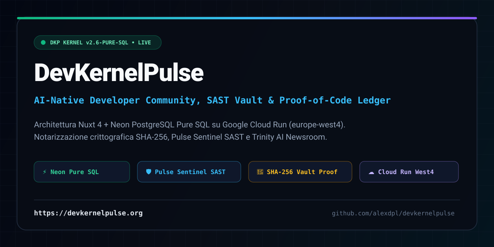

# DevKernelPulse — DKP Kernel v2.6-PURE-SQL

**DevKernelPulse** ([https://devkernelpulse.org](https://devkernelpulse.org)) is an engineering community platform, editorial hub, and SaaS ecosystem running on **DKP Kernel v2.6-PURE-SQL** on **Google Cloud Run** (\europe-west4\) and **Neon PostgreSQL (Pure SQL)**.

## Core Architecture (v2.6-PURE-SQL)
- **Pure SQL Engine**: Direct parameterized SQL queries on Neon PostgreSQL; zero legacy \/api/v2.5/\ routes.
- **Official SDK**: \@devkernelpulse/sdk@1.1.0\ (see \sdk/README.md\).
- **Sentinel SAST & Grammar**: Passive real-time grammar/code auditing in \DkpEditor.vue\ and \/api/tools/sentinel-scan\.
- **SaaS Shop & Mail Nexus**: Stripe checkout/webhooks, \dkp_live_...\ API keys, and SMTP/Resend Mail Nexus.

## Setup & Deploy
```bash
pnpm install
pnpm dev
pnpm run build
pnpm run build:sdk
```
