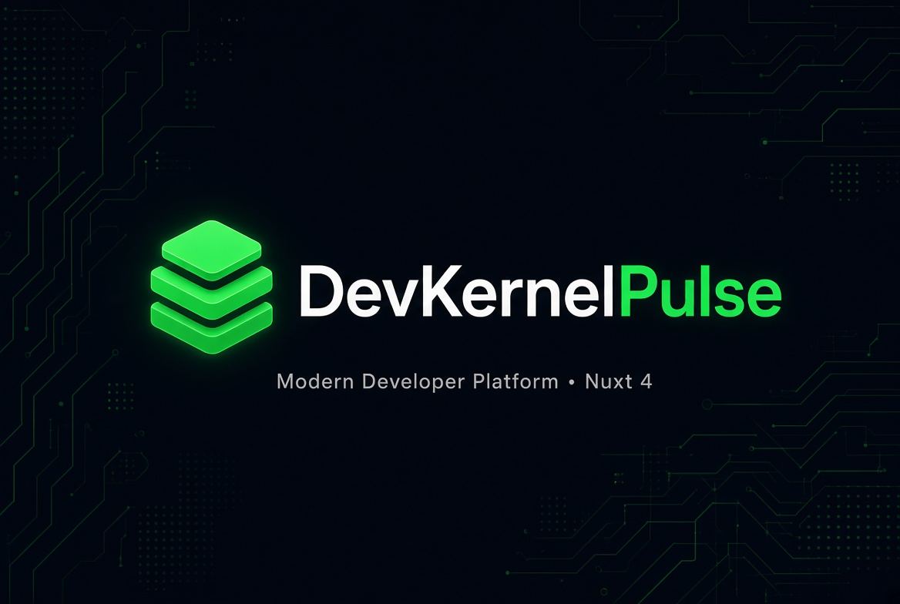

# DevKernelPulse

[](https://nuxt.com)
[](https://www.typescriptlang.org/)
[](https://pnpm.io)
[](https://opensource.org/licenses/MIT)
[](https://devkernelpulse.org)

<p align="center">
  
</p>

**DevKernelPulse** is a modern developer platform built with Nuxt 4.  
Official website: [https://devkernelpulse.org](https://devkernelpulse.org)

---

## 🚀 Live

🌐 **Production**: [https://devkernelpulse.org](https://devkernelpulse.org)

> Currently hosted on **Google Cloud Platform (GCP)**

---

## ✨ Features

- Modern & fast Nuxt 4 architecture
- Blog system with related posts
- Public user profiles with social links
- DKP Points system
- Dark theme optimized UI
- SEO friendly
- Server-side rendering (SSR)
- Fully responsive

---

## 👥 Team

Built with ❤️ by the DevKernelPulse team.

---

## 👨‍💻 Author

**@alexdpl**  
Lead Engineer Architect & Core Creator of DevKernelPulse

- GitHub: [github.com/alexdpl](https://github.com/alexdpl)
- X: [x.com/alexdpl76](https://x.com/alexdpl76)
- LinkedIn: [linkedin.com/in/alexdpl](https://linkedin.com/in/alexdpl)

---

## 🛠 Tech Stack

- **Framework**: [Nuxt 4](https://nuxt.com)
- **Database**: Neon (PostgreSQL) + Drizzle ORM
- **Styling**: Tailwind CSS
- **Package Manager**: pnpm
- **Hosting**: Google Cloud Platform (GCP)
- **Language**: TypeScript

---

## 📦 Build Setup

**Requires Node.js 18+**

```bash
# Install dependencies
pnpm install

# Start development server
pnpm dev

# Build for production
pnpm build

# Preview production build
pnpm preview
```
---

## 📄 License

This project is licensed under the **MIT License**.

MIT License

Copyright (c) 2026 Alessandro De Paola (@alexdpl)

Permission is hereby granted, free of charge, to any person obtaining a copy of this software and associated documentation files (the "Software"), to deal in the Software without restriction, including without limitation the rights to use, copy, modify, merge, publish, distribute, sublicense, and/or sell copies of the Software, and to permit persons to whom the Software is furnished to do so, subject to the following conditions:

The above copyright notice and this permission notice shall be included in all copies or substantial portions of the Software.

THE SOFTWARE IS PROVIDED "AS IS", WITHOUT WARRANTY OF ANY KIND, EXPRESS OR IMPLIED, INCLUDING BUT NOT LIMITED TO THE WARRANTIES OF MERCHANTABILITY, FITNESS FOR A PARTICULAR PURPOSE AND NONINFRINGEMENT. IN NO EVENT SHALL THE AUTHORS OR COPYRIGHT HOLDERS BE LIABLE FOR ANY CLAIM, DAMAGES OR OTHER LIABILITY, WHETHER IN AN ACTION OF CONTRACT, TORT OR OTHERWISE, ARISING FROM, OUT OF OR IN CONNECTION WITH THE SOFTWARE OR THE USE OR OTHER DEALINGS IN THE SOFTWARE.


